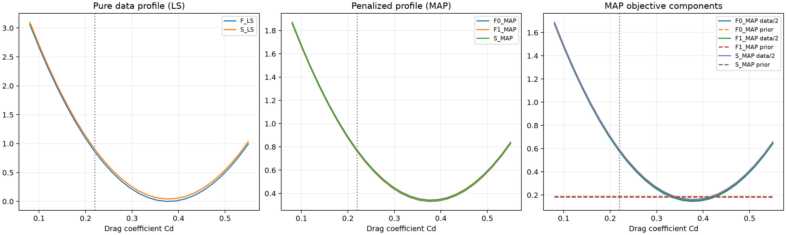
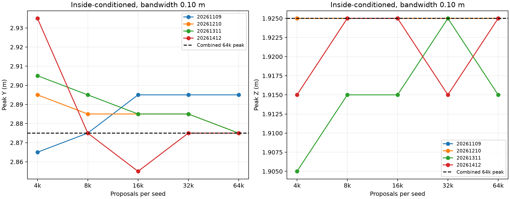
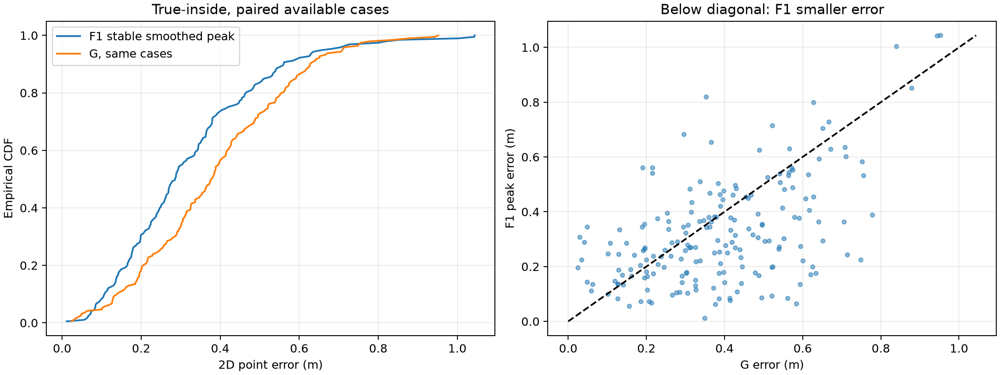
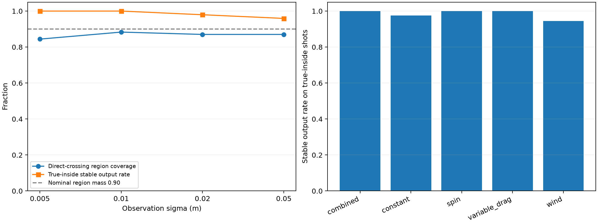
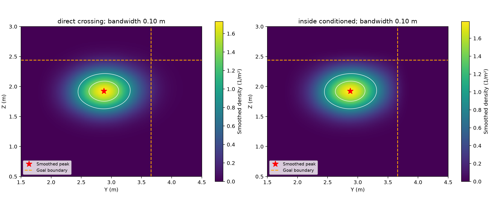
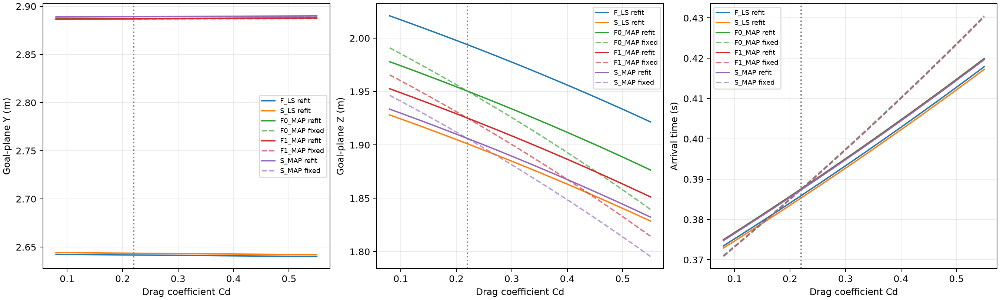
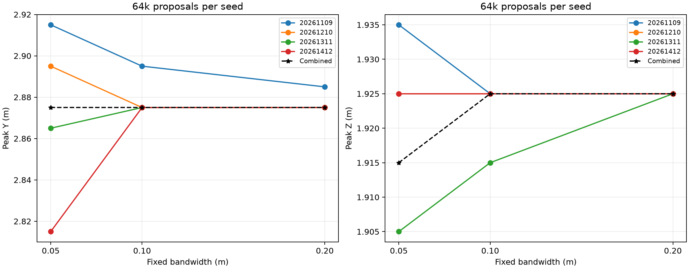

# 论文图表清单与可用图注

主图按三项实验顺序排列。所有图片直接复制自已有结果，未修改图中数据。主图3为四档噪声合计，主要1cm层数值使用性能总表，不混淆口径。

## 主图1：阻力重拟合剖面

文件：[figures/fig01_drag_fit.png](figures/fig01_drag_fit.png)。
原图：[原实验图片](../整理阻力剖面实验/拟合剖面图.png)。

建议图注：指定算例的F/S纯数据LS剖面、F0/F1/S的MAP目标及其分解。竖线为冻结Cd=0.22；网格最小层不是实测阻力。MAP目标不能跨模型直接作证据排名。

## 主图2：指定算例平滑峰的采样量检查

文件：[figures/fig02_mode_convergence.png](figures/fig02_mode_convergence.png)。
原图：[原实验图片](../算例稳定性实验/sampling_convergence.png)。

建议图注：入框条件、带宽0.10m；每种子4k至64k前缀的峰位置，虚线为四种子合并64k峰。前缀来自同一固定提议分布，不是各预算重新构造提议的独立实验。

## 主图3：最终平滑峰与G的误差比较

文件：[figures/fig03_point_errors.png](figures/fig03_point_errors.png)。
原图：[原实验图片](../最终主点性能实验/point_errors.png)。

建议图注：49条真实入框源的四档噪声中，193组共同成功观测的误差CDF与配对散点；同源副本相关。该图是四档合计，不是仅1cm层；49条1cm主结果见性能总表。

## 补充图S1：覆盖率及稳定输出分层

文件：[figures/figS01_region_stability.png](figures/figS01_region_stability.png)。
原图：[原实验图片](../最终主点性能实验/coverage_and_stability.png)。

建议图注：区域覆盖以真实直接过线案例为分母；稳定输出比例以真实入框案例为分母。两条曲线样本条件不同，不能直接比较大小来判断同一任务的成功率。

## 补充图S2：题目指定算例的平滑密度

文件：[figures/figS02_case_density.png](figures/figS02_case_density.png)。
原图：[原实验图片](../算例稳定性实验/kde_density.png)。

建议图注：两种条件的0.10m合并KDE及其峰。白色线是峰值50%和80%的等密度线，不是90%预测区域；无真实后续位置，不能凭此图评价准确性。

## 补充图S3：阻力变化对门线量的影响

文件：[figures/figS03_drag_goal.png](figures/figS03_drag_goal.png)。
原图：[原实验图片](../整理阻力剖面实验/门线预测变化图.png)。

建议图注：实线逐层重拟合，虚线固定名义MAP其他参数的前向扫描。轨迹MAP点不是正式KDE主点，扫描跨度也不是预测误差或概率区间。

## 补充图S4：指定算例带宽敏感性

文件：[figures/figS04_bandwidth.png](figures/figS04_bandwidth.png)。
原图：[原实验图片](../算例稳定性实验/bandwidth_sensitivity.png)。

建议图注：0.05/0.10/0.20m带宽下各64k种子与等权合并峰。支持指定算例对所检验平滑尺度较稳定，不支持任意带宽或无限分辨率唯一众数。

## 正文表格建议

- 表1使用性能总表中的1cm层F1/G配对误差，明确n=49源。
- 表2使用稳定输出比例及直接过线区域覆盖；按不同分母分区或加脚注。
- 四档误差、噪声分层和机制分层放附录；不能把196组噪声观测写成196条独立射门。
