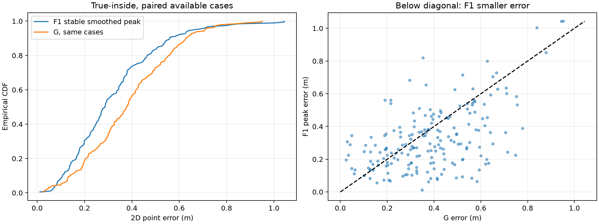
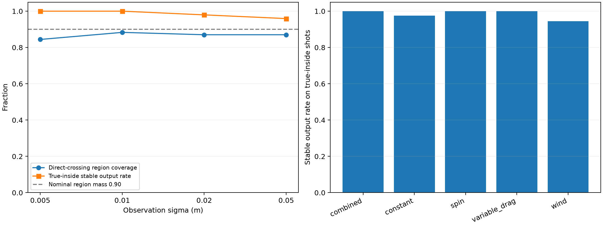

# 冻结 F1：批量主点稳定性与最终主点性能实验

日期：2026-11-08（Asia/Shanghai）。模型、先验、Cd、带宽、区域阈值未修改。
使用已有independent_200测试部分100源、400观测；这是已使用测试数据上的冻结方法补充评价，不是新盲测。
每条可用观测四种子各64k提议；先保存候选和稳定性状态，全部预测封存后才由评分程序读真值。

## 数值实现与检查

MAP与混合t提议沿用inverse/uncertainty；同一动力学采用经原积分器对照及步长减半验收的C批量RK4（步长0.005s、Hermite事件定位）。不把加速实现当成新物理模型。
原始候选以每种子NPZ保存，包含物理参数、log_target、log_proposal、权重、事件、过线位置/时间及观测窗位置；拒绝候选保留。

## 稳定性口径

主点为入框条件下0.10m固定带宽平滑峰，网格0.01m；四种子分别条件归一化后等权合并。32k与64k是同一提议分布前缀。
四种子均须通过原采样诊断，条件ESS在32k和64k均≥100；主带宽跨种子直径及最大加倍移动均≤0.20m，且峰不在搜索边缘。
整门框加0.60m扩边用于入框条件搜索；直接过线窗口由预测均值±6标准差再扩0.60m确定，不读真值。
另保存0.05/0.20m峰与原始格网诊断，原始格网未通过不冒充平滑峰未通过。未发布的原始峰只作探索性记录，不混入正式点误差。

## 样本与输出

- 总源数100、观测数400、完整可用观测380。
- 真实入框：49源/196观测；稳定主点193，未通过3，比例0.9847。
- 真实直接过线：77源/308观测；区域提供303。

## 入框条件点误差

| 方法与样本口径 | n | 中位误差/m | P90/m | RMSE/m |
|---|---:|---:|---:|---:|
| F1稳定平滑峰 | 193 | 0.2859 | 0.5605 | 0.3756 |
| G，所有可用入框案例 | 195 | 0.3786 | 0.6275 | 0.4302 |
| F1，共同成功子集 | 193 | 0.2859 | 0.5605 | 0.3756 |
| G，共同成功子集 | 193 | 0.3786 | 0.6277 | 0.4313 |
| F1入框条件均值，辅助 | 196 | 0.2960 | 0.5641 | 0.3821 |

共同成功子集的中位误差差F1−G，按机制分层、按源整组配对bootstrap 2000次，95%区间：[-0.1352664965230317, -0.04271938666203331]m。负值支持F1误差较小；区间跨零则不支持明确优势。
全体真实入框观测中，同时稳定且误差≤0.5m的比例：0.8214；失败保留在该分母。

## 空间区域

冻结阈值3.083525用于新四种子合并的直接过线后验协方差；缺失区域计漏覆盖。实际覆盖0.8669，95%源级区间[0.8246193021379589, 0.90625]，面积中位0.9887m²。
该区域是经验校准区域，不宣称严格conformal保证。其样本条件与入框峰误差不同。

## 主要噪声层：sigma=0.01m

真实入框49观测，稳定比例1.0000；共同成功子集F1中位误差0.2709m，G为0.3739m；区域覆盖0.8831，面积中位0.7688m²。

## 噪声分层

| sigma/m | 入框n | 稳定输出率 | 配对F1中位误差/m | 配对G中位误差/m | 过线区域覆盖 | 面积/m² |
|---|---:|---:|---:|---:|---:|---:|
| 0.005 | 49 | 1.0000 | 0.1967 | 0.3625 | 0.8442 | 0.3897 |
| 0.01 | 49 | 1.0000 | 0.2709 | 0.3739 | 0.8831 | 0.7688 |
| 0.02 | 49 | 0.9796 | 0.3404 | 0.3591 | 0.8701 | 1.1044 |
| 0.05 | 49 | 0.9592 | 0.3704 | 0.4153 | 0.8701 | 1.5214 |

## 机制分层

| 机制 | 入框n | 稳定输出率 | 配对F1中位误差/m | 配对G中位误差/m | 过线区域覆盖 |
|---|---:|---:|---:|---:|---:|
| combined | 44 | 1.0000 | 0.3716 | 0.3868 | 0.8281 |
| constant | 40 | 0.9750 | 0.2783 | 0.3831 | 0.8529 |
| spin | 48 | 1.0000 | 0.2484 | 0.3257 | 0.8750 |
| variable_drag | 28 | 1.0000 | 0.2679 | 0.5657 | 0.9167 |
| wind | 36 | 0.9444 | 0.2739 | 0.2984 | 0.8750 |

## 未通过原因

```json
{
  "seed_0:sampling_diagnostics": 2,
  "seed_1:sampling_diagnostics": 1
}
```

## 结论边界

本批数据的配对区间支持F1平滑峰相对G的中位误差改善。
稳定输出比例与条件误差必须同时报告，不能只展示通过案例的误差。不能将数值稳定性解释为真实精度、唯一众数或全局最优。
H的气动机制为合成压力设置，未匹配具体实测球型；没有实测外部验证。四档副本不是独立源，bootstrap始终整源重采样。





## 复现

```bash
.venv/bin/python code/final_point_evaluation.py run --workers 4
.venv/bin/python code/final_point_evaluation.py score
```
run可复用已完成案例及原始候选，不重复采样。source/与run_config.json固定实现和输入；prediction_manifest.json记录评分前封存的完整预测。

## 补充解读

全部输入的稳定提供率、原始格网通过率、主要噪声层的配对区间及新旧区域口径差异，见 [INTERPRETATION.md](INTERPRETATION.md)。本报告的“稳定主点”始终指固定带宽平滑峰。
