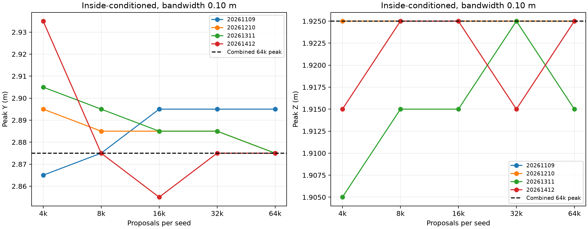
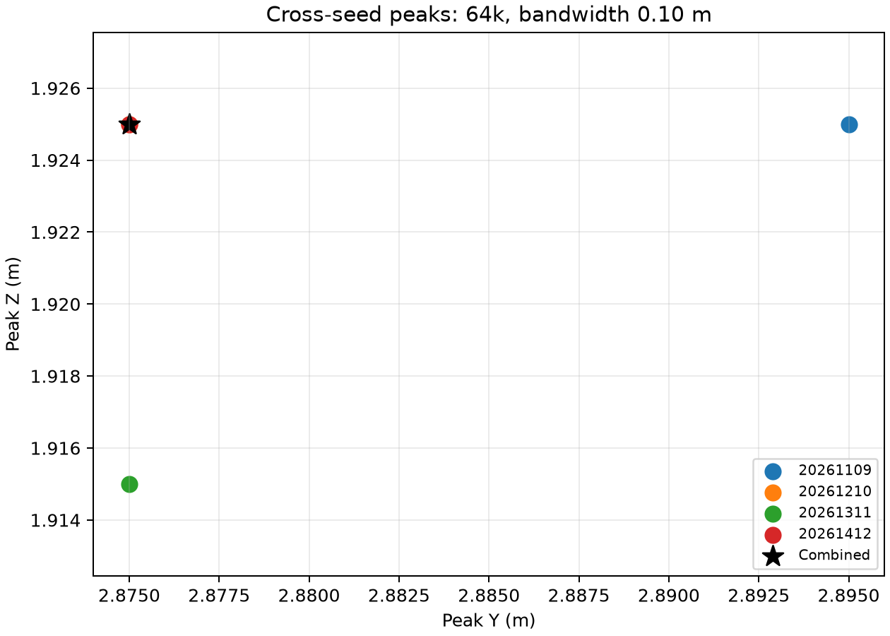
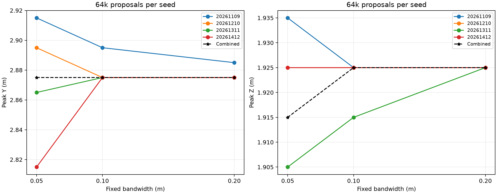
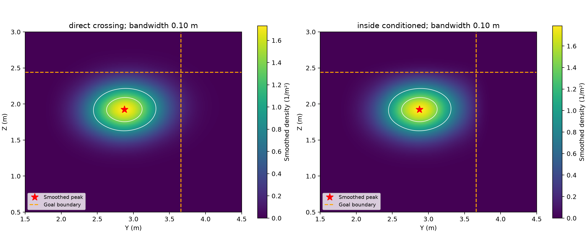

# 当前 F1 算例稳定性实验：重新采样与完整留档

日期：2026-11-08（Asia/Shanghai）。

本次按当前冻结F1重新生成候选；模型、先验、Cd、误差假设、带宽与判据均未调优。
仅使用题目指定的两帧坐标，不访问开发、校准、测试真值。

F1先验by/bz尺度0.10/0.20，Cd=0.22，sigma=0.01m。四个预先指定种子，每种子64k提议。
主带宽0.10m；0.05/0.20m仅作敏感性；门槛沿用0.20m。direct crossing和inside-conditioned分开。
所有原始提议均保留，包括零权重、拒绝和未决候选；每种子条件归一化后等权合并。
搜索窗口与原实验一致；不因窗口截断重新归一化。密度图为固定带宽平滑估计，边界附近会有核平滑越界。

## 采样诊断

| 种子 | 提议数 | ESS | 未决质量 | 通过 |
|---|---:|---:|---:|---|
| 20261109 | 64000 | 44253.1 | 0 | True |
| 20261210 | 64000 | 44124.8 | 0 | True |
| 20261311 | 64000 | 44227.8 | 0 | True |
| 20261412 | 64000 | 44223.1 | 0 | True |

## 主点与带宽敏感性

| 带宽/m | 合并峰(Y,Z)/m | 跨种子直径/m | 32k→64k最大移动/m | 通过 |
|---|---|---:|---:|---|
| 0.05 | (2.875, 1.915) | 0.1005 | 0.0806 | True |
| 0.10 | (2.875, 1.925) | 0.0224 | 0.0141 | True |
| 0.20 | (2.875, 1.925) | 0.0100 | 0.0100 | True |

## 原始格网对照

```json
{
  "within_seed_grid_diameter_m": 0.18328218983608596,
  "base_cross_seed_m": 0.10166666666666657,
  "base_last_doubling_m": 0.0,
  "pass": true
}
```

## 与旧结果比较

旧主带宽跨种子直径 0.0224m，新值 0.0224m；旧加倍移动 0.0141m，新值 0.0141m。旧记录已按用户要求清理；此处保留重跑时记录的对照数值。

## 结论与范围

- 主带宽合并峰为(2.875, 1.925)m；稳定性通过：True。
- 峰是否位于搜索边缘：False；平滑密度窗口外质量约1.1e-08。
- 原有阈值下检测竞争峰数：1；高密度连通区域数：1。未发现竞争峰不能证明连续密度全局唯一。
- 固定随机种子与设置用于复现实验，不通过挑种子或带宽追求更好结果。
- 支持的是指定算例、当前模型和固定平滑尺度下的数值稳定性；不证明真实预测准确，也不证明其他射门均稳定。
- 4k/8k/16k行是同一64k固定提议分布的前缀诊断，不等于分别以不同预算重新构造提议运行。
- 本次采样、分析与绘图耗时约164.9s。

## 图表









## 文件与复现

seed_*/candidates.jsonl.gz为逐条原始候选；seed_*/summary.json为各次诊断；kde_peaks.csv/grid_modes.csv为完整统计；kde_density.npz为密度图数值。
run_config.json保存输入及源码指纹；source/保留源码；artifact_manifest.json校验所有文件。旧版重复结果已于2026-11-08按用户要求删除，当前目录是唯一保留的完整结果。

从项目根目录运行（新目录必须不存在）：

```bash
.venv/bin/python code/final_mode_stability.py --output results/算例稳定性实验/再次运行 --workers 4
```

仅从已保存候选重新分析与绘图：

```bash
.venv/bin/python code/final_mode_stability.py --output 'results/算例稳定性实验/重新运行_20261108' --analyze-only
```
